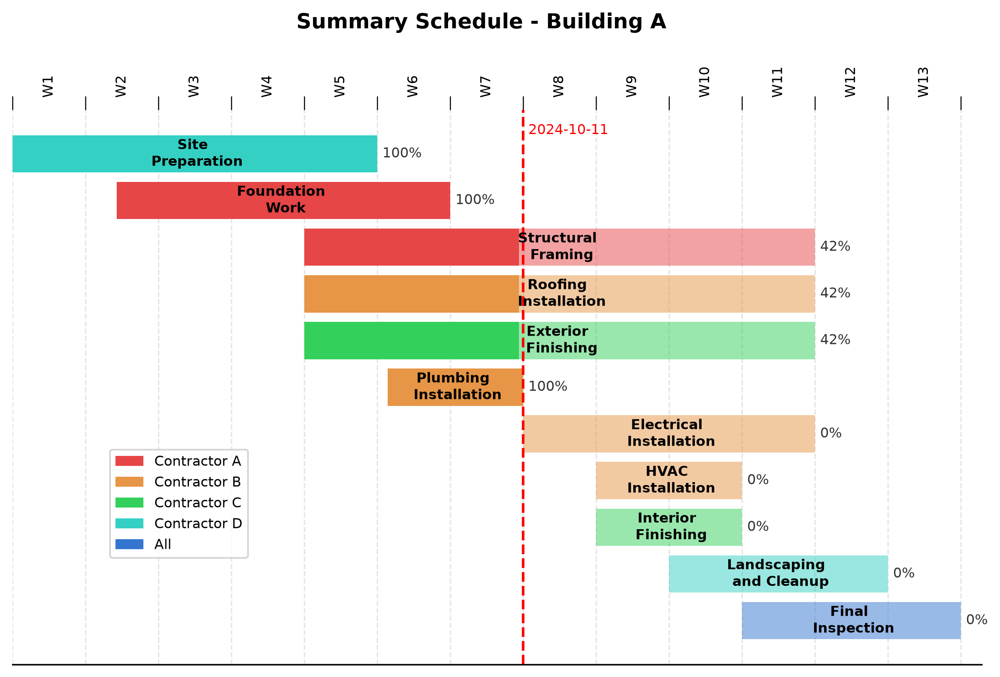

# Gantt Chart (`gantt_plot.py`)

프로젝트 일정과 진행률(Completion)을 시각화하는 간트 차트(Gantt Chart) 스크립트입니다.

## 코드 설명

1. **프로젝트 데이터 정의 (`data`)**
   - 작업명(`Task`), 담당 부서/계약자(`Department`), 시작일(`Start`), 종료일(`End`), 진행률(`Completion`)을 딕셔너리 형태로 정의합니다.

2. **데이터 전처리 (`DATA PREP`)**
   - `pandas.DataFrame`으로 변환한 뒤, 프로젝트 전체 시작일(`proj_start = df.Start.min()`)을 기준으로 각 작업의 시작일(`start_num`), 종료일(`end_num`), 전체 기간(`days_start_to_end`), 현재까지 진행된 기간(`current_num`)을 일(day) 단위 숫자로 계산합니다.
   - 담당자(`Department`)별로 색상을 매핑(`color` 컬럼)하고, 차트 위에서부터 첫 번째 작업이 표시되도록 DataFrame 순서를 역순으로 정렬합니다.

3. **차트 시각화 (`PLOT`)**
   - `ax.barh()`를 두 번 호출하여, 전체 기간 막대(`alpha=0.5`) 위에 완료된 기간 막대(불투명)를 겹쳐 진행률을 표현합니다.
   - 각 막대 중앙에 작업명을, 막대 오른쪽 끝에 진행률(`%`)을 텍스트로 표시합니다.
   - 상단 x축(`ax_top`)을 추가해 7일(1주) 간격의 주차 라벨(`W1`, `W2`, ...)을 표시하고, 불필요한 테두리(spine)와 하단 눈금을 숨깁니다.

4. **범례 및 기준선 (`LEGENDS` & Status Line)**
   - `Patch`를 이용해 담당자별 색상 범례를 추가합니다.
   - 특정 기준일(`2024-10-11`)에 빨간색 점선(`ax.axvline`)과 날짜 라벨을 표시해 현재 시점을 나타냅니다.

5. **이미지 저장 및 출력**
   - `plt.savefig('gantt_chart.png', dpi=300, bbox_inches='tight')`로 같은 폴더에 `gantt_chart.png`를 저장한 뒤 `plt.show()`로 화면에 출력합니다.
